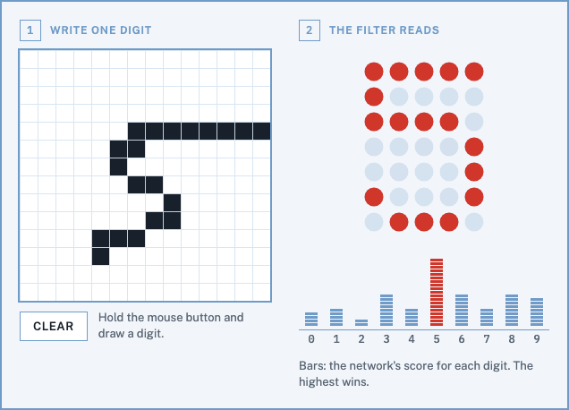

# fenet

Draw a digit and SVG filters read it. The page has no JavaScript: CSS records the drawing, and a chain
of 320 filter primitives, mostly `feConvolveMatrix`, runs a small neural network on it.

**[Try it](https://fmindstormer.github.io/fenet/)**: hold the mouse button and draw a digit in box 1.



## Where it works

- **Chrome, Edge, Brave and Arc**, on a computer or an Android phone. Firefox and Safari place filter
  pixels differently and would misread, so they get the recording above instead of the pad (every
  browser on iPhone and iPad uses Safari's engine).
- **A mouse or trackpad.** On a touchscreen, dragging doesn't move `:hover`, so cells are tapped one at
  a time; the page says so on touchscreens.
- **Most zoom levels**: 76 device pixel ratios from 0.5 to 5, which covers the browser's preset zoom
  levels on common screens. Others hide the reading and ask for 100 %.
- **Shown unscaled.** A frame that scales the page (the claude.ai artifact viewer shows pages at 90 %)
  hides the scale from the media queries, and the network reads an empty pad.

## One prediction

The opening example, as the filters see it. The values are the filter graph's own, from the emulator:



1. **Strokes**: 14 × 14 cells on the pad.
2. **Pixels**: 196 `:has()` rules copy the cells into screen pixels; a threshold and a 3 × 3 blur follow.
3. **Layer 1**: 192 neurons, each one `feConvolveMatrix` with 196 weights over the whole image plus a
   bias, clamped to 0…1, writing one pixel of this 14 × 14 image (the faint dots mark the neurons).
4. **Layer 2**: 96 neurons, the same way over layer 1's image.
5. **Scores**: ten more neurons, one per digit.
6. **Answer**: `feMorphology` finds the highest score, and a second filter prints it as a dot-matrix digit.

The detail follows.

```
drawing pad (CSS :active + :hover, transition delay of 1,000,000 s)
   │ 196 :has() rules
   ▼
14 × 14 mirror, one cell = one device pixel (media queries scale it by 1/devicePixelRatio)
   │ filters #net1–#net3 — one SVG filter per layer, on nested groups around the mirror
   ▼
threshold → 3×3 blur → 192 neurons → 96 neurons → 10 scores → argmax → tie-break
   │ CSS filter on the result SVG: url(#x<ratio>) url(#render)
   ▼
dot-matrix digit + ten score bars, coloured from the page's theme
```

## How it works

**Drawing.** `.grid:active rect:hover` turns a cell dark with `transition: fill 0s`. Every other state
of a cell has `transition: fill 0s 1000000s`, so when the pointer leaves, the cell waits a million
seconds before going back. Clear is a `<label>` for a radio button: while it is pressed every cell
gets `transition: none` and snaps back. The opening example is an overlay on the pad (and on its mirror)
shown only while the radio is unchecked and the pad isn't pressed. The pad sits in a second `<label>` for
the same radio, so the first press hides the example and the click that ends it checks the radio, which
stays checked. Before that, a first stroke landed on top of the example: a 7 drawn there was read as 5.

**Mirror.** For each of the 196 cells, a rule like
`.app:has(.grid:active rect:nth-child(37):hover) .mirror rect.m:nth-of-type(38)` paints the matching
cell of a 14 × 14 square inside the result SVG, with the same million-second trick. The square sits in
a group scaled by `1/devicePixelRatio` (one media query per supported ratio), so each cell is exactly
one device pixel, which is the unit `feConvolveMatrix` works in.

**Network.** One `feConvolveMatrix` per neuron. The kernel is 14 × 14 (196 taps), its target is the
neuron's own pixel, and its subregion is that one pixel, so the primitive computes a full dot product
over the previous layer's image plus a bias, and clamps it to 0…1. Each layer is merged onto a black
square, because `preserveAlpha` copies the source's alpha.

Each layer is its own filter, on nested groups with the first layer innermost. A group's content is drawn
once before its filter runs, so a layer reads the one below as a finished image. In one big filter,
Chromium's GPU raster would compute layer 1 again for every layer-2 neuron and give up (see below).
The ink flag, whether anything is drawn at all, rides along in pixels no neuron uses: (13, 6) in
layer 1, (13, 9) in layer 2.

| stage | primitives |
|---|---|
| threshold + 3×3 blur | 2 |
| hidden layer 1 (positions spread over the 14 × 14 image), ink flag | 192 + flood + 1 + merge |
| hidden layer 2, ink flag moved to (13, 9) | 96 + flood + 1 + merge |
| scores at slots (1 + 4·(k mod 4), 1 + 4·⌊k/4⌋) | 10 + flood + merge |
| argmax: `feMorphology` dilate to the max, `feComposite` 1 + score − max, lookup table "is exactly 1" | 3 |
| tie-break: one 25 × 9 convolution, +1 at the pixel, −1 wherever an earlier slot can sit | 1 |
| output: winner block and ink flag in red, each score as a 3 × 3 block in green | 8 |

Everything the display reads is a uniform 3 × 3 block of device pixels, centred on a slot: the
winner flag in red and the score in green. At fractional ratios the compositor applies the CSS filter at
a coarser scale than the content was drawn, so a single pixel blurs into its neighbours, while the
middle of a block keeps its value.

**Display.** The result SVG's CSS filter is two filters in a row. `#x<ratio>` copies the middle pixel of
each slot's block (flag and score) and of the ink block into 4 × 4 CSS-pixel blocks; there is one per
supported ratio. `#render` (shared) tiles each block over the readout and masks a 5 × 7 dot-matrix digit
(`feImage` of a data-URI SVG) and a segmented bar per class. Bar segment *i* lights when the score
reaches its level: `feComposite arithmetic` with k2 = 255, k3 = −255, k4 = 1 against a stepped ramp.
Colours come from `flood-color: var(--mark)` and friends, so the readout follows the page's light or
dark theme.

## Results

| | |
|---|---|
| network | 196 → 192 → 96 → 10, 57,322 weights, clipped-linear activations, 8-bit |
| MNIST test, pooled to 14 × 14 | 96.7 % |
| MNIST test, skeletonized to one-cell strokes | 95.0 % |
| pen-written digits, 14 writers it never saw (UCI Pendigits test, drawn 10 cells tall) | 94.8 % (82.0 % when trained on MNIST alone) |
| emulator vs NumPy model | the same answer for 9,991 of 10,000 MNIST test digits; the 9 others are near-ties, with the top two scores less than one 8-bit step apart |
| Chromium vs NumPy model | the page prints the model's answer for all 200 MNIST test digits at each of 8 zoom levels from 0.75 to 3, with GPU and with software raster (`logs_agreement.txt`). Chromium's convolutions don't round exactly like the emulator, so a near-tie can still go either way |
| page size | about 710 kB, all inline except the Google Fonts stylesheet |
| time per painted cell | under 0.1 s in Chromium 156 on an Apple M4, GPU or software raster (`time_frames.py`, screenshot included) |

**Real handwriting.** MNIST was written mostly by US Census staff and students, and its 9s and 1s are
plain strokes. [UCI Pendigits](https://archive.ics.uci.edu/dataset/81) has 10,992 digits written with a
stylus by 44 people, kept as pen paths. `pendigits.py` draws each path onto the pad the way a mouse drag
paints it. Replayed as real drags on the page, 200 validation digits got the same answer from the model as
from `draw()` for 198 of them (accuracy 97.0 % against 98.0 %); the differences are cells that a line only grazes.
Trained on MNIST alone, the network read only 82.0 % of the test writers' digits. On validation, 9s were
mostly read as 3 (their tails curl left, which on 14 × 14 cells looks like a 3's lower bowl) and 1s as 7
(a long upstroke). So training now fills on average 30 % of each batch with Pendigits training digits,
given random size, slant, rotation and position. That share was set in advance, not tuned. A stylus is
not a mouse, so the Pendigits figure measures handwriting styles more than mouse drawing.

**Splits.** MNIST's 60,000 training digits are split as published: 50,000 to train on and 10,000 for
validation. Pendigits' 30 training writers are split at random, two thirds to train on and one third
for validation. The file is shuffled and carries no writer IDs, so the two parts share writers, and
Pendigits validation (97 %) flatters the model. Its 14 test writers are kept apart. Every choice made from results reads
validation only: the saved epoch (`train_mlp.py`, by MNIST clean, augmented and thin accuracy plus
Pendigits), the score scale (`check_mlp.py`) and the opening example (`pick_sample.py`). The test digits of both sets
are read only by `evaluate.py` and the Chromium checks, after the weights, the scale and the page are fixed. The numbers above
come from one such run. The architecture, the 40 epochs, the learning-rate schedule and the augmentation are
unchanged from an earlier version that trained on all 60,000 digits and saved the epoch with the best test
accuracy. They were settled while test accuracy was visible, so the figures may still be slightly optimistic.
That version reported 97.0 % and 95.0 %. The gap mixes the selection effect with 10,000 fewer training
digits, and this run cannot separate the two.

## Chromium facts it depends on

Found with the probes in `probe/`, in headless Chromium with software raster unless GPU raster is named
(`probe28.py`: Chromium 156, Apple M4):

- `feConvolveMatrix` works in device pixels and ignores `kernelUnitLength`.
- A kernel with more than 256 taps is ignored and the result is transparent. 196 fits.
- `edgeMode="none"` reads zero outside the input; with `preserveAlpha` the result keeps the source alpha.
- Results are stored as 8-bit premultiplied colour between primitives. Training rounds every activation
  the same way (straight-through gradients).
- With software raster, a shared input is computed once when every consumer asks for the same
  rectangle, as a layer's neurons do. GPU raster (Chrome and Arc on a Mac) computes it again for every
  consumer, and a filter whose work grows too far comes out transparent: 96 layer-2 neurons over a
  196-primitive layer 1 did, and the limit fell between 43 and 44 of them. Hence one filter per layer.
- With software raster, a shared node with consumers of different kinds can make Chromium evaluate
  everything above it again: `feBlend` was the worst (the argmax took five times longer than with
  `feComposite arithmetic`), and a second branch of score neurons cost almost as much.
- A filter sees its source only inside its own filter region.
- An element with `will-change: transform` is rasterized from a whole device pixel at a scale of
  max(1, devicePixelRatio). That makes the mirror land on pixels at fractional ratios. Below a ratio of 1
  the CSS filter on that layer runs at the screen's scale while its content is drawn at 1, so the readout
  is scaled up by 1/ratio to bring the two together.
- A CSS filter on a composited layer runs at a coarser scale than the layer's content at fractional
  ratios: one device pixel of content smears over its neighbours. Values meant to be read are 3 × 3 blocks.
- `feTile` from a subregion smaller than a device pixel reads nothing; reading a 3 × 3 CSS-pixel square
  inside a uniform 4 × 4 block works at every ratio tested.
- Gradients are dithered, so the bar ramp is drawn as solid steps.
- `visibility: hidden` does not stop a filter from painting; unsupported ratios use `display: none`.
- An SVG filter's output is its last primitive, whatever its `result` name.

## Rebuild

[Release v1.0.0](https://github.com/fMindstormer/fenet/releases/tag/v1.0.0) freezes the model and its
evaluation: the weights, the score scale, the built page, the recording, the diagram and the logs.

Needs Python 3.13 with the exact versions in `requirements.txt` (`pip install -r requirements.txt`, then
`playwright install chromium`). The data isn't in the repository:

| file | from | sha256 |
|---|---|---|
| `data/mnist.pkl.gz` | `data/mnist.pkl.gz` of mnielsen/neural-networks-and-deep-learning | `f11bb9e41d6c1b6c124aa38fd605497bdcfe2ee08cf7c2bb5a41ab5d759e1416` |
| `data/pendigits/pendigits-orig.tra` | [UCI dataset 81](https://archive.ics.uci.edu/dataset/81), uncompressed from the `.Z` file | `a66225d68d7d68591e62944df1ad33b3f5aa608e2df2505844b41f5568a80da4` |
| `data/pendigits/pendigits-orig.tes` | the same | `ddb1c19e277a56c7ffe682cc024d6ab73696f9adcc1643ef9ed5aa753007e081` |

Run everything from the repository root:

```
python train_mlp.py 40 mlp.npz                 # 192 and 96 hidden units; saves the best epoch on validation
python check_mlp.py                            # score scale (alpha.json) and emulator vs model, on validation
python pendigits.py 6,8,10,12,13               # validation: Pendigits accuracy by digit height
python pick_sample.py 5 1364                   # the opening example (sample.json), from validation
python diagram.py                              # site/prediction.svg
python build_page.py                           # site/index.html and site/test.html
python record.py && python build_page.py       # site/fenet.gif; the page reads its size
python evaluate.py 10000                       # test: MNIST and Pendigits accuracy, emulator vs model
python browser_check_mlp.py 200 1,1.25,2      # test: filter vs model in Chromium, by device pixel ratio
python test_draw.py 1,1.5,2                    # a first visit: mouse strokes over the example, Clear, more digits
```

With these versions, training from scratch reproduces `mlp.npz` byte for byte (sha256
`5b4e7feb185ad21fba09b0f1db1560b63e5768bd84f5343beb6975a10ca44362`), and with it `alpha.json` and
`sample.json`. `train.log` matches apart from the epoch timings. Checked on an Apple M4; other CPUs
may round differently. `logs_evaluate.txt` and `logs_agreement.txt` are the frozen test results.

The Chromium checks run full Chromium, which rasterizes on the GPU where there is one, as desktop
browsers do; `RASTER=sw` forces software raster.

`site/test.html` is the standalone page; GitHub Pages builds and serves it with the recording
(`.github/workflows/pages.yml`). `site/index.html` is the same page without a document skeleton, for
hosts that add their own. `build_page.py` and `test_draw.py` run without MNIST. The scripts in `probe/`
and `attic/` import modules from the root, so run them as `PYTHONPATH=. python probe/probe21.py`.

## Files

| file | role |
|---|---|
| `train.py` | MNIST loading, 14 × 14 pooling, augmentation (also holds the earlier CNN attempt) |
| `train_mlp.py` | the perceptron, thin-stroke augmentation, Pendigits in the batches, quantization-aware training |
| `pendigits.py` | Pendigits pen paths drawn onto the pad, its splits, augmentation |
| `compile_mlp.py` | network → filter graph, NumPy emulator of the graph, SVG writer |
| `build_page.py` | the page: drawing rules, ratio media queries, extract and render filters |
| `site/template.html` | page markup and styles |
| `check_mlp.py` | score scale from validation, emulator check |
| `evaluate.py` | the test figures, run once the model and page are fixed |
| `eval_thin.py`, `compare_models.py` | accuracy on validation: thin strokes, model against model |
| `browser_check_mlp.py`, `test_draw.py` | Chromium checks; `test_draw.py` draws as a first visitor would, straight over the example |
| `record.py`, `site/fenet.gif` | the recording: real mouse strokes on the real page |
| `diagram.py`, `site/prediction.svg` | one prediction, step by step, from the emulator; the page has the same panels inline |
| `probe/` | the experiments behind the facts above, and screenshot helpers |
| `attic/` | the earlier CNN attempt, stopped by the 256-tap limit |
| `mlp.npz`, `alpha.json`, `sample.json` | trained weights, score scale, opening example |
| `facts.json` | accuracy and agreement figures quoted on the page |
| `train.log`, `logs_evaluate.txt`, `logs_agreement.txt` | the training run, the test evaluation and the Chromium agreement run |

## Limits

Besides the browsers, input and zoom levels under [Where it works](#where-it-works):

- The zoom levels are a device pixel ratio of 1, the 65 ratios above 1 listed by `ratios()` in
  `build_page.py`, and ten common ratios below 1.
- The browser check is by CSS feature: `-moz-appearance` (Firefox), `hanging-punctuation` (Safari) and
  missing `:has()`. It was tested in Playwright's Chromium and WebKit; Firefox wouldn't start in the
  test environment, so its branch is untested.
- Drawing only adds ink; Clear starts over.

## License

MIT, Fedir Yudin. MNIST by Yann LeCun, Corinna Cortes and Christopher Burges. Pendigits by E. Alpaydin and
F. Alimoglu, UCI Machine Learning Repository, CC BY 4.0.
